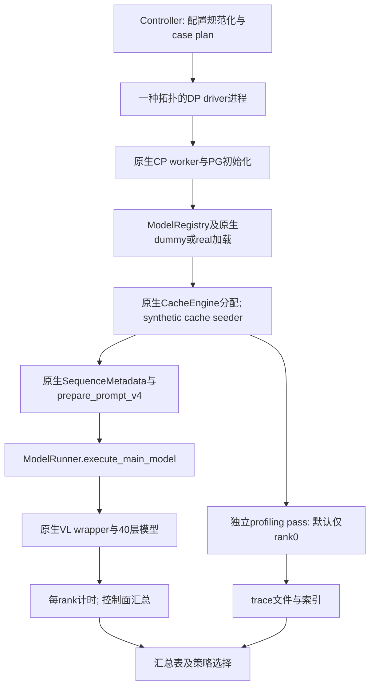

# DeepSeek V4.1 Flash / Ascend 950 Prefill Benchmark 设计

状态：v0.1 实现及 CPU 验证已提供，2026-10-26。当前 Windows 开发环境没有 Ascend NPU，Linux 构建、八卡运行、kernel trace 对齐和性能门槛均待 950 验收。下文已更新实际进程/文件接口；第 13 节硬件验收目标仍须实测。

## 1. 目标与已确认的范围

构建一个直接复用 DeepInfer 的 Prefill benchmark，系统扫描输入长度、虚拟缓存命中率及并行策略，输出 forward 时延、吞吐、各 rank profiling 文件及策略比较结果。性能路径的一致性优先于模型数值精度。

用户已确认：

- 只支持 Ascend 950，使用同一高速互联域中的 8 张卡。
- 并行策略固定为 DP8CP1EP8、DP4CP2EP8、DP2CP4EP8、DP1CP8EP8。
- 默认原生 dummy 权重，同时支持真实 checkpoint 对照。
- 同时支持固定全局请求数和固定每 DP 请求数，以固定全局请求数为主要比较口径。
- 首版所有 DP 输入相同长度、相同命中率；保留后续异构 DP 输入扩展接口。
- MoE 使用 DeepInfer 原生强制负载均衡，不运行动态 EPLB 重排。
- 首版 SWA bounded replay 支持 decoder YOCO 的 off/mask/compact；默认 compact、keep=140。
- encoder SWA miss、回退128 token重算不属于首版，配置中明确拒绝该场景。
- 软件基线为 CANN 9.2.0、Python 3.12、torch 2.13.0+cpu、torch_npu 2.13.0rc1。

首版只测纯文本 Prefill。无 decode、sampler、LM head logits、结构化输出、VE 计算、服务端排队、外部前缀检索、SSD/3FS、P→D 传输。保留原生文本模型 wrapper、Engram、HC、indexer、量化/缓存路径与 forward 内的 DSpark cache preparation。

“dummy”只替换参数内容；不缩层、不缩 hidden/expert 数，不关闭 Engram，不替换 attention/MoE，不缓存或绕过 top-k，不手工填一个均匀的 MoE route 来代替原生 gate。

## 2. 基线、依赖与兼容性约束

### 2.1 版本固定

| 组件 | 设计基线 |
| --- | --- |
| DeepInfer | `553741557a57df44a46fb3ab72b6aafeaf945337` |
| 模型 | `deepseek-ai/DeepSeek-V4.1-Flash-1017` |
| 模型 revision | `1bae0e1088993b9b82de08f59de5be5a34e42170` |
| DeepEP-Ascend | `3b25377d04b24fc6154698ded78a2bcb2c59afff` |
| DeepGEMM-Ascend | `3a35326271b069b8b5bf1a754435acd6cc91575b` |
| FlashMLA | `2e5429fc5653bab6e081f09477126f731882a6a9` |
| DeepSelect | `bfa4507d935f17ebfc3d0f00ff7d3c9a4d0e5c18` |
| Python / PyTorch / torch_npu | 3.12 / 2.13.0+cpu / 2.13.0rc1 |
| CANN | 9.2.0，保留厂商实际包版本字符串；不只按浮点数或字符串前缀匹配 |
| C++ / device compiler | GCC≥13，支持 C++20；使用该 CANN 的 Bisheng、链接器和头文件 |
| TileLang / TileKernels | 0.1.15 / 2.1.0，与主仓库 requirements 保持一致 |

其余 Python 包复用主仓库 `requirements*.txt`；最终部署还输出完整 `pip freeze` 和 wheel SHA256。基线更新必须显式改变 compatibility version，并重新做 metadata、kernel 路径和性能验收，不自动追踪 main。

驱动/HDK/固件、Linux发行版、CPU架构、glibc和容器镜像digest在目标950首机部署时记录并锁定。目前用户未指定这些值，文档不虚构已验证镜像或固件版本。仓库 vendor 的历史结果使用特定950DT和PoC HDK，其数字不是本benchmark的已验证结果。[R01][R02]

### 2.2 保持哪些实现不变

| 环节 | 直接复用的 DeepInfer 实现 | benchmark新增内容 |
| --- | --- | --- |
| 模型配置/加载 | ModelConfig、ModelRegistry、原生 loader/materialization | dummy/real选择、文件校验与版本清单 |
| Worker/PG | WorkerBase资源初始化、`init_parallel_groups`、原生CP worker广播 | BenchWorker方法和进程生命周期管理 |
| 参数布局 | 原生FP8/FP4权重处理、MegaMoE/SymmBuffer、共享KV拓扑 | 记录真实shape/stride/分支 |
| KV/state | CacheEngine、GPUCacheInterface、StateBlock | 所需容量规划、合法随机cache填充、状态快照 |
| 输入metadata | SequenceData/SequenceMetadata → ModelMetadata → C++ prepare_prompt_v4 | 构造请求描述和seqlen_q/seqlen_k；不重写派生张量 |
| forward | `ModelRunner.execute_main_model()` 内的原生注册模型调用 | 只读计时hook、范围标记和结果收集 |
| CP / YOCO | 原生mirror、all-gather、compact边界、full-KV source路径 | 参数选择和布局核验 |
| kernel | Ascend FlashMLA、DeepGEMM、DeepSelect、TileLang、DeepEP | profiler采集与指纹比较 |

原生架构注册为 `DeepseekVLForCausalLM`，即使纯文本也有其embedding和image-mask路径；不能直接换成底层 `DeepseekModel` 来减少几次调用。[R03]

## 3. 工作负载、缓存命中率与shape定义

### 3.1 术语

| 符号 | 定义 |
| --- | --- |
| L | 单请求完整输入token数，包含cached prefix |
| h_req | 用户指定命中率，范围[0,1] |
| C | 对齐后实际cached prefix token数 |
| U | 需要计算的新token数，`U=L−C` |
| B_dp / G | 每DP组请求数 / 8卡总请求数，`G=DP×B_dp` |
| Q_j / K_j | 第j个forward中单请求的query数 / 可见历史加当前query长度 |
| P | cache block粒度，本模型为128个原token |
| W / B / K_keep | SWA窗口128 / 回退余量 / YOCO保留长度140 |

本benchmark中的命中率是“每条请求拥有多长的resident HBM prefix”，不是“多少请求命中缓存”。所有请求都具有C长度的虚拟前缀；h不控制NPU L2命中率。结果必须标明 `cache_source=synthetic_hbm`。

### 3.2 规范化规则

默认 `alignment_policy=floor`，所有策略共用同一次规范化结果：

实现以Decimal或有理数解析h_req，避免二进制浮点舍入使block边界发生意外变化；原始输入字符串和规范化结果同时保存。

```text
required_suffix = K_keep    if yoco.mode in {mask, compact}
                  1         if yoco.mode == off
C_cap = P × floor(max(0, L-required_suffix) / P)
C_target = floor(L × h_req)
C = min(P × floor(C_target / P), C_cap)
U = L-C
h_effective = C/L
```

compact/mask采用140-token新后缀约束，是首版不恢复旧decoder SWA时的保守benchmark契约；不能将其声称为生产服务唯一命中策略。它与Q&A的134-token回退余量并非同一参数。

例：L=8192、h_req=0.99、compact140时，C_cap=7936，最终C=7936、U=256、h_effective=0.96875。请求的99%不能直接写进报告作为实际99%。

L≤140仍可运行，C=0；100%目标也被下调，不能生成零query的forward。`alignment_policy=exact`则在目标prefix不能精确表示或超过cap时返回INVALID_CONFIG，禁止静默改变。必须记录block对齐和suffix限制分别造成的调整原因。

首版C总为128的倍数，避免引入额外C2跨block未完成压缩状态语义。更细粒度C不是首版验收项。

### 3.3 两种执行方式

**single_forward，CLI默认值：** `Q=U，K=L，SequenceData.full_len=L`，一次调用计算完整新后缀。若超出HBM或kernel资源限制，返回OOM/UNSUPPORTED；不偷偷切chunk后还称single forward。

**chunked_suffix，长序列扫描配置使用：** 显式给出每请求 `chunk_tokens_per_request=T`，第j步：

```text
Q_j = min(T, U-j×T)
K_j = C+j×T+Q_j
SequenceData.full_len = L     # 每步保持完整输入长度
```

同一DP的B_dp条请求按相同进度参与各步；首版所有DP也同进度。该规则是受控benchmark workload plan，不声称复刻线上FIFO/时间预算scheduler。C++metadata和每一步的模型执行仍为原生实现。

两类结果单独排名。chunked_suffix同时输出每步forward时延和全后缀forward链时延；不得用某个较快的中间chunk代表整个输入。吞吐分子始终按本轮实际计算的有效新token累计，YOCO裁行不改变用户侧U。

## 4. 四种拓扑和公平比较

固定8张设备的顺序为devices[0:8]。原生rank映射为 `global_rank=dp_rank×CP+cp_rank`，CP组连续，EP组覆盖全部8个rank；首版ENP=8，与原生默认一致。[R04]

| 策略 | DP | CP | EP | CP组global ranks | 固定G=8时B_dp |
| --- | --- | --- | --- | --- | --- |
| DP8CP1EP8 | 8 | 1 | 8 | {0},…,{7} | 1 |
| DP4CP2EP8 | 4 | 2 | 8 | {0,1},{2,3},{4,5},{6,7} | 2 |
| DP2CP4EP8 | 2 | 4 | 8 | {0,1,2,3},{4,5,6,7} | 4 |
| DP1CP8EP8 | 1 | 8 | 8 | {0,…,7} | 8 |

**fixed_global（默认）：** G在所有策略相同，默认G=8。所有策略一起扫描时要求G为8的倍数，禁止补dummy请求改变工作量。比较相同G、L、C、执行方式和YOCO参数的batch时延与总吞吐。

**fixed_per_dp：** B_dp固定，默认1，则G分别为8/4/2/1。用于观察单请求/每DP负载不变时CP的延迟收益与8卡总吞吐代价；报告必须显示G变化，不能宣称四种策略处理了相同总工作量。

在fixed_global下，同样的global_request_id使用同一组token/cache造数seed，再按DP重新分组。CP复制同一逻辑请求的KV，不将其重复计入G或吞吐。不同请求不共享物理cache block，防止fork别名造成过于乐观的cache locality。

CP每rank物理query行数必须按原生mirror的 `Σ_i 2×ceil(Q_i/(2CP))` 推导（CP1为ΣQ_i），不能用整数除法`ΣQ_i//CP`替代。prefill token容量、MoE SymmBuffer和Engram容量均覆盖该pad上界。

长context下CP不等比例节省KV：每CP rank仍需要本组请求的完整cache视图与相关buffer。容量预估按B_dp×L计算，并报告所有rank的最大实际HBM，而不是只看rank0。

## 5. 运行架构及原生forward复用



### 5.1 实现目录与模块职责

实际模块划分如下：

```text
benchmarks/prefill_ascend950/
  DESIGN.md / README.md
  cli.py                  # doctor / plan / run / summarize / compare
  config.py               # 严格 JSON 配置、规范化和配置hash
  planner.py              # workload、chunk轨迹、容量与比较分组
  launcher.py             # 原生DP/CP映射、超时、失败广播和退出
  worker.py               # BenchWorker、原生 forward、根模块 event hooks
  doctor.py               # 版本/硬件检查和隔离子进程预检
  alignment.py            # CPU metadata 值/模块布局重复性签名
  workload.py             # 原生请求描述、cache 量化造数和 state 快照
  profiler.py             # 全 rank trace、NPU kernel 和 active 范围检查
  report.py               # 指标、排名、heatmap与错误汇总
  deploy.sh / collect.sh
  deployment.py           # 固定 revision 小文件准备、wheel/扩展 hash
  configs/smoke.json / sweep.json / fixed_per_dp.json
  environment.lock.json   # 声明基线；目标机 resolved lock 另存 venv
tests/benchmarks/prefill_ascend950/
```

不复制 `attn.py`、`mlp.py`、`prepare_tensor_input_v4.cpp` 或vendor kernel到benchmark中；不创建一套“等价简化模型”。若native adapter必须随上游内部API改变而更新，用兼容版本管理，禁止静默降级。

### 5.2 进程与初始化

controller 保持不导入 torch/deepinfer，直接 spawn 八个模型执行进程。每个子进程先按原生 CP 组设置可见设备，再导入平台并进入 WorkerBase 初始化。不能再外套 torchrun。world_size=8 是 device rank 数。

BenchWorker 复用 WorkerBase 生命周期；仅将 follower 的阻塞 RPC loop 替换为父控制器安排的同步 benchmark loop。cp_rank=0 仍是 driver，CP follower 仍调用原生 `_prepare_input_follower`，metadata 的 HCCL 广播不变。各 rank 进行原生模型、Engram 和 PG 初始化，EngineType.PROMPT；warmup 使用同一 Prefill workload。

权重选择为`load_format=dummy/auto`，调用原生`load_model(skip_load=...)`，不把dummy误当成配置文件不存在也能运行。dummy仍需要固定模型config和tokenizer.json，并通过该基线原生loader的文件预检；配置下载使用allowlist，禁止为了dummy自动拉取所有safetensors。real模式需要完整模型目录。[R05]

### 5.3 forward计时hook

每次仍调用 `ModelRunner.execute_main_model(seq_metadata_list, gpu_cache)`。计时 pass 采用批计时：第一个 forward 前恢复 state 并同步一次，随后在 NPU stream 上记录一个 start event，连续下发 `iterations` 次 forward（chunked_suffix 为 `iterations×chunks` 步），中间不插入 synchronize、barrier 或 restore；最后一个 forward 返回后记录 end event，统一等待后按 `total_ms / forward 数` 计算平均值。根模型上的 pre/post hook 只做 forward 计数和 profiling `record_function`，不逐次记录 event，不修改输入、输出或分支。计时范围包含原生 wrapper、embedding、Engram、所有40层、内部CP/YOCO metadata工作和DSpark主缓存准备。

hook内不做synchronize、barrier、日志落盘或CPU读取tensor；这些操作会破坏launch行为，且原生forward有`forbid_cuda_sync`守卫。事件等待、指标归并和内存采样均在`execute_main_model`返回后进行。原生CPU metadata/H2D/broadcast的wall成本另行采集，不从device时长相减推算。[R06]

所有CPU/GPU跨rank同步在批计时区间外完成。批开始前的控制面同步只保证8个rank准备进入该批；批内不插入barrier，各rank仅通过原生集合通信对齐。批跨度包含该rank实际forward中的通信等待和host下发间隙，是隔离forward指标，不冒充严格统一时钟的跨卡makespan。

新hook若无法正确覆盖原生异步子流完成依赖，验收失败：必须用NPU trace确认end event位于相关工作完成之后。禁止简单相加kernel duration作为forward时延。

### 5.4 批量执行与容错

`batch.enabled=true` 时 controller 对同一并行策略的 case 分组，每组 spawn 一次八个 rank；子进程内加载一次模型，随后按固定顺序执行组内全部 case。每个 case 仍完整走原生 cache 分配、synthetic cache 造数、state 快照、alignment/warmup、计时和 profiling；case 结束释放 cache/state 与 per-case metadata，模型、Engram buffer 与通信 workspace 常驻。计时口径与单 case 完全一致。

模型构建时的 `max_num_batched_tokens` 决定通信 workspace 规模（实测约 128 KB/token），所以分组按 case 需要的 `max_rows_per_rank` 取 2 的幂分桶（`capacity_grouping=power2`），每组容量取组内最大；`single` 为每策略一次加载（大 L 低命中会 OOM，整组失败）。这样“一次加载”不会用一个 1M case 的容量拖垮全部 case。

失败语义分两级。**可恢复失败**限定在 case 的任何集合通信之前：per-case 的 `CacheEngine` 分配 OOM、`seed_cache` 失败、首个原生 metadata 构造失败。这些操作只碰本 rank 的 HBM，不进入 HCCL，因此进程组仍然健康。失败 rank 写 `rank_*/error.json`，随后八个 rank 用 Gloo `all_reduce(MAX)` 对标志位协商（0=全部就绪，1=可恢复跳过，2=致命）；因为失败的 rank 无法加入本 case 后续的 HCCL 集合通信，协商必须发生在第一次 forward 之前。标志为 1 时每个 rank 写 `skipped.json`（失败 rank 同时保留 error.json），launcher 用 `outcome.json ∥ skipped.json` 判定 case 已完成，按 rank error 把 case 标为 FAILED/OOM 并在**同一进程组**继续下一个 case，模型、Engram buffer 与通信 workspace 不重载；失败 rank 的异常 traceback 会在协商前丢弃，避免其栈帧钉住已分配的 cache tensor。**致命失败**是 forward/集合通信中的错误（device error 507035、HCCL 错误等）或准备阶段的非内存类 device/kernel 错误：进程退出，launcher 终止整组、把当前 case 标为 FAILED，然后用剩余 case 重新加载继续；组内模型加载失败则只把该组剩余 case 标为 FAILED，继续下一组。`runtime.case_timeout_s` 按 case 计时（从上一个 case 完成或模型就绪开始）。进度写 stdout：TTY 下为原地刷新的进度条（已完成/总数、ok/failed、当前 case/模型加载），非 TTY 退化为逐行输出；组日志写 `groups/.../rank_*/worker.log`，`ready_rank_*.json` 用于区分加载失败和 case 失败。诊断用 `PREFILL950_FAIL_CASE`（致命）与 `PREFILL950_FAIL_CASE_RECOVERABLE`（可恢复）注入。

## 6. metadata契约

### 6.1 只构造请求描述，不重写派生metadata

每DP driver持有B_dp个原生SequenceMetadata：

```text
is_prompt = True
seq_data = SequenceData(完整L个合法token)
compressed_seq_data = 原生CompressedTokenizer.encode(完整token)
seqlen_q = 本step Q_j
seqlen_k = 本step K_j
multi_modal_data = None
block_table = 本请求实际分配的物理blocks
state_id = 独立、非保留的合法slot
request_id != PLACEHOLDER_REQUEST_ID
```

sampling_params使用原生类型构造供metadata接口读取，但不调用sampler。raw与compressed token历史都保持完整；Engram n-gram需要cached prefix附近的token，不能只给U个token。

CP follower接收原生`_prepare_input_follower`广播结果，不自行推导一份近似metadata。由原生ModelMetadata建立PrepareArgs，并调用C++ `prepare_prompt_v4`；cu_seqlens、positions、ks/ke、load_segments、slot_mapping、SWA pivots、YOCO字段、mirror/reverse、valid_token_mask等全部走原生路径。[R07]

### 6.2 生命周期和复用

- 每次forward重新创建或原生重新构造InputMetadata；不能重用已经执行过`prepare_for_mirror_cp`/YOCO字段重绑定的对象。
- SequenceData按pybind keep_alive规则保持存活；owned dummy metadata在本轮结束前不释放底层历史数据。
- block0/state0保留给dummy/placeholder，不分配给有效请求；不同请求blocks和可写state不重叠。
- 同一CP组各rank的逻辑block表、state slot、L/C/Q/K相同，设备存储各自存在；不同DP组可使用独立本地物理block空间。
- YOCO边界由原生模型触发，不在benchmark中先gather到140行再只跑后20层。
- 所有capacity设置显式保存，尤其固定`max_model_len=1048576`与其原生runtime扩展，避免长度扫描同时改变indexer row stride/chunk size。

### 6.3 metadata一致性核验

独立alignment pass同时产生：

1. 原生ModelMetadata/C++prepare路径的CPU输出签名。
2. driver/follower完成H2D广播后的shape、dtype、stride、numel与可用标量。
3. 只读observer记录forward内mirror和compact边界的行数、positions、valid token数、source映射及关键索引摘要。

同一case的baseline与benchmark，确定性的索引/metadata字段要求逐项一致；物理地址本身允许不同但block别名、对齐和stride约束必须相同。强制路由随机数受seed/执行顺序影响，不要求模型输出精度或所有top-k值跨不同并行策略一致。

## 7. synthetic cache与SWA bounded replay

### 7.1 合法布局的假缓存

通过原生CacheEngine分配每个请求覆盖L的cache block和独立state；通过GPUCacheInterface的owning/source views填充，不重复分配consumer共享KV。

CacheSeeder为每请求生成不同的、有界有限BF16源数据，再通过原生cast/store接口形成main FP4、index FP4和SWA FP8的数据及scale布局；compression state按原生FP32布局准备。合法scale、有限值和有效索引是执行有效性要求，不是精度验收。

容量规划先计算至少`1 + B_dp×ceil(L/128)`个逻辑block（含保留block0），然后调用原生cache布局函数计算实际stride、对齐和padding；state slot数量通过原生`get_num_state_slots`确定。额外预算包括DSpark state、Engram、SymmBuffer、CP buffers、indexer logits以及BF16 KV materialization，不能仅按891 B/token作准入判断。造数/快照所需临时内存也纳入准备阶段峰值，不能只看torch allocator；长期占用与实际forward峰值分别记录。

不允许随机写uint8字节导致NaN/非法scale；也不将所有cache/权重/token置同一个常量来制造高度重复top-k和过热L2。seed、数据分布、cache block分配策略和地址复用策略都写入结果，承认dummy与随机KV可能改变数据依赖访存性能。

虚拟prefix默认已经在HBM中，造数和prefix初始化不计时；不为了构造某个h先算一遍C长度前缀。可选real-prefix对照是额外实验，其准备时间也单列。

### 7.2 迭代状态恢复

single_forward每次测量前恢复初始prefix所需state，在计时区外完成复制并等待；query区域可由本次原生forward正常更新。每个case第一次及异常恢复时初始化整个可访问cache，保证无未初始化读取。

chunked_suffix每轮仅在整条trajectory开始前恢复初始state；不同chunk之间保留上一chunk生成的main/SWA/compression state。禁止在每个chunk前恢复初始state，导致后续chunk丢失历史。每轮结束后再为下一轮恢复。

默认测量steady resident-cache情形，不称为cold-L2带宽测试。状态恢复也可能影响L2，原生对照采用相同准备规则。若后续支持buffer rotation/冷cache，作为独立cache-policy维度，不与steady结果合并。

### 7.3 YOCO配置与运行约束

| 参数 | 默认 |
| --- | --- |
| mode | compact；另支持off/mask |
| keep_tokens | 140 |
| MTP draft length | 5，保持上游默认；不运行draft decode |
| max backtracking | 6，实际值按原生`max(configured, NEXTN+1)`解析 |
| store extra state | true，明确匹配上游YOCO benchmark；off模式也显式记录 |
| encoder SWA状态 | available；miss为首版不支持 |

执行前检查`keep_tokens >= 128 + effective_backtracking`。改变MTP配置会改变forward中的特征/缓存准备和state容量，不自动因“不测decode”设为0。[R08]

full_len=L必须一直正确：早期chunk可能在decoder只保留一个不写ring的占位query；保留区跨chunk时，decoder计算行数不能简单固定为B_dp×140。每step记录producer raw/padded query数、consumer raw/padded query数和full-KV更新行数。

compact仍通过原生layer20 full-hidden分支生成完整新增main/index KV。mask只限制SWA可见域，不节省完整query/MLP行数；off、mask和compact分别比较，默认不合并到同一“最佳并行策略”组。[R08]

## 8. MoE强制均衡与运行参数

使用原生`DEEPINFER_FORCE_LOAD_BALANCE=1`，确保C++metadata和mirror后的gate mask都反映该值；`DEEPINFER_FORCE_IMBALANCE_RATIO=0`，防止覆盖。设置`EXPERT_REARRANGEMENT_STEP_INTERVAL=0`，没有动态EPLB shuffle或统计flush夹在计时中。

冗余专家默认32，与上游examples公共配置对齐；实际物理数为416、EP8每rank52个routed expert slots。该参数是实验配置的一部分，不能与使用384物理专家的结果混排。若改为0，原生路径仍可跑，但必须建立独立比较组。

原生强制均衡是受控随机路由，并不保证小batch时每rank token数完全相同。沿用原生gate和logical→physical映射；在计时外读取expert_count增量，报告observed_moe_lb，不能为了凑成1.0再修改route。计数在轮次边界清理，不调用仅为sampling服务的EPLB step。[R09]

Ascend上标准配置应进入FP8×FP4 MegaMoE。启动验收记录 `use_mega_moe`、`mma_type`、共享专家融合标志、gate路径及SymmBuffer布局；若落入其他实现，结果标记PATH_MISMATCH，不假装完成性能对齐。

其他原生NPU默认设置保持一致，包括deterministic kernel策略、TASK_QUEUE_ENABLE、HCCL选项、Engram设备存储和CPU/NUMA绑定。环境解析在import DeepInfer前完成；每个配置输出resolved参数，不能靠shell值推断生效结果。

关键默认环境映射如下；CLI/config为配置源，解析后显式设置，发现冲突须报告，禁止残留shell变量偷偷改变图：

| 原生环境变量 | 默认resolved值 |
| --- | --- |
| DEEPINFER_ACCELERATOR | ascend |
| DEEPINFER_FORCE_LOAD_BALANCE | 1 |
| DEEPINFER_FORCE_IMBALANCE_RATIO | 0 |
| DEEPINFER_OVERRIDE_NUM_EXTRA_EXPERTS | 32 |
| DEEPINFER_EXPERT_COUNT_WINDOW_SIZE | 3，与上游example一致；不运行动态重排 |
| DEEPINFER_EXPERT_REARRANGEMENT_STEP_INTERVAL | 0 |
| DEEPINFER_USE_NEXTN_DECODE | 5 |
| DEEPINFER_MAX_BACKTRACKING_TOKENS | 6 |
| DEEPINFER_YOCO_PREFILL_TRUNCATION_MODE | compact |
| DEEPINFER_YOCO_PREFILL_KEEP_TOKENS | 140 |
| DEEPINFER_PREFILL_STORE_EXTRA_STATE | 1 |
| DEEPINFER_PREFILL_STORE_EXTRA_SIZE | 128 |
| DEEPINFER_ZERO_OVERHEAD_SCHEDULING | 0，符合PROMPT引擎默认值；没有decode pipeline |
| DEEPINFER_BATCH_INVARIANT | 0，950当前不支持该功能 |

PROMPT引擎不做decode graph capture，但保持forward内部原生实现。与上游NORMAL模式结果交叉对照时，必须核对ZOS引起的runtime最大长度和容量差异；不能只对齐用户可见的max_model_len。

## 9. 计时、吞吐与排名

### 9.1 测量阶段

```text
版本/硬件/文件预检
→ native初始化、dummy/real加载和cache准备
→ 全shape warmup与JIT收敛
→ timing pass（profiler关闭）
→ 独立profiling pass（默认仅rank0；可配all）
→ 统一汇总和排名
```

默认每case warmup=0、iterations=10、rounds=1（`iterations` 为批内连续 forward 次数）。可缩短smoke，但smoke不授予性能对齐PASS。冷启动、模型加载和JIT时间另列，不并入steady forward。profile轮次不进入timing统计。

所有rank在批结束时保存一个批总事件跨度；返回后等待并将结果通过控制面收集。第r轮、第j步的主指标：

```text
span0[r] = rank0 批 start/end event 跨度（round r）
B[r] = span0[r] / (iterations × chunks)     # rank0 单步平均
t[j] = B[r]                                  # 只取 rank0
single_forward: T = t[0] = span0 / iterations
chunked_suffix: T = Σ_j t[j]
```

其余 rank 只参与执行与 outcome 完整性校验，不参与时延统计；trace 默认也只保留 rank0（`profile.export_ranks=rank0`）。

批量计时下所有 iteration 共享同一平均值，raw samples 每个 chunk 都等于 `B`，因此 p50/p95/mean 相同、CV=0；这是“平均 forward 时延”口径，不用于估计分布尾部。

批内不插入同步；host 侧 metadata 构造与下发若无法被异步队列掩盖，会以设备空闲形式计入批跨度，这是连续 forward 的真实成本，不是线上TTFT。禁止把它与 engine.step wall 直接比较。

首个 forward 的 metadata 在 start event 之前构造：256K prompt 的 `SequenceData`（raw + compressed）构造约 31–33ms，只会出现在 profiling trace 起始处，不计入批跨度。

只取 rank0 的另一个原因是不同 rank 的 span 不可比。首个 forward 的 metadata 在 start event 之前构造：CP driver（rank0）花约 62ms 构造它（每 DP 2 条请求 × raw+compressed `SequenceData`），这段时间被排除在自己的 span 之外；CP follower 的 metadata 为空，`start.record()` 更早生效，但它的第一个 forward 要等 driver 构造完并通过 `_prepare_input_follower` 广播，这段等待落在 follower 自己的 span 内。结果 follower 的 span ≈ driver 的 span + 首个 metadata 构造时间：实测同一 CP 对内 follower 比 driver 高 4.9–7.3ms/forward（49–73ms/批），与 62–65ms 的构造时间吻合；而两者的 batch wall 几乎相同（366.2–368.0ms/forward），profiling trace 中同一 CP 对的设备时间线也几乎一致（如 1033.8 vs 1033.1ms/3 个 forward）。因此不能跨 rank 比较 span；只取 rank0（driver）得到的是“不含首个 metadata 构造等待”的设备受限批平均，而旧的取最大值口径会把 follower 的这段一次性等待摊进每次 forward。

### 9.2 统计和吞吐

报告mean、p50、p95、p99、min、max、标准差、CV。批计时下所有样本等于批平均，因此 p50=p95=mean、CV=0；保留 raw samples 与 quantile 算法，sample 少时不声称可靠 p99。主吞吐用总工作量除总计时时间，不平均每步token/s：

```text
new_tokens_per_iteration = G×U
new_tokens_per_s = Σ_k(G×U) / Σ_k(T[k]/1000)
new_tokens_per_s_per_card = new_tokens_per_s / 8
requests_per_s = Σ_k G / Σ_k(T[k]/1000)
```

可附加`logical_input_tokens_per_s=Σ(G×L)/ΣT`，必须标为包含命中前缀的logical口径；默认图表使用new_tokens_per_s。mirror pad、YOCO占位和CP副本不算有效token。

### 9.3 策略选择

compare_key至少包括：硬件/软件基线、model/config/tokenizer hash、weight mode、L、C、batch mode及对应G或B_dp、execution、chunk plan、YOCO/extra-state/MTP、expert redundancy、memory/cache policy和timing scope。策略自身的DP/CP是被比较变量。

fixed_global输出最低p50/最低p95 forward latency和最高new-token throughput对应策略；fixed_per_dp额外显示G变化，给出latency/throughput Pareto，不输出脱离目标的单一冠军。可选latency budget则在满足预算者中选吞吐最高。差异小于测量噪声时标记tie/不确定，不强行排第一。

OOM、PATH_MISMATCH、INVALID_CONFIG、PROFILE_FAILED、TIMEOUT和UNSUPPORTED点保留在表中。排除失败点不等于宣布其策略在整个长度/命中率区域较差。

## 10. profiling契约

profiling 默认关闭（`profile.enabled=false`）；显式开启后使用目标torch_npu的CPU+NPU profiler，独立profile pass默认只采 rank0（`profile.ranks=rank0`，设为 `all` 才全采）；采集阶段不解析trace，解析留到离线（`profiler.save_profile_index`）。profiling pass采用连续批执行：批前只restore并同步一次，中间不插入synchronize/barrier/restore，避免两次forward之间出现设备空泡；`profiler.step()`只做host侧步进。`profile.continuous=false` 可回退为每个profiled forward前restore+同步的旧式采集：连续模式在只采rank0时对CP2 + 256K/0.97实测触发device error 507035（vector core exception，kernel不固定），原因是profiler开销只压在rank0、CP/MoE集合通信错位。稳定方案为 `profile.ranks=all` + `profile.export_ranks=rank0`：所有rank对称运行profiler，仅rank0导出trace，其余rank的采集写入`profiler_discard`临时目录并在结束后删除；实测forward间设备空隙0.2–0.6ms，同步式约66ms。这些开关只影响profiling采集，不影响timing。不沿用只能采driver的HTTP profiler。优先标准`torch_npu.profiler`接口，能力预检检测目标版本支持的活动、级别、schedule和导出函数，不在模块import时假定私有experimental字段一定存在。[R10]

profiling 默认关闭（`profile.enabled=false`，benchmark 默认只做计时）；开启后的默认 preset：Level1、ranks=rank0、export_ranks=rank0、wait=0、warmup=0、active=3、record_shapes=true、with_stack=false、profile_memory=false，即 profiling pass 共 3 次 forward。所有rank执行相同step计划，仅选中rank记录trace；不使用同一个输出文件名。性能量化完全来自关闭profiler的timing pass。

标准导出保留原生Ascend结果目录、timeline/summary及rank→文件索引。采用trace-handler导出时不再对同一个profiler对象重复调用`export_chrome_trace`，避免接口模式冲突；从原生结果确定可消费的trace文件，并记录路径。Level1/2或硬件counter采集为显式额外preset，目标栈不支持则报明原因。

只读范围标记至少有case/iteration/chunk/forward；metadata构造、cache restore在forward范围外可见。shape/branch alignment pass可使用更多observer，正式timing移除这些额外观测开销。不要将异构rank的绝对时间戳直接拼接成已对时的timeline。

采集后`profiler_index.json`只记录`status=COLLECTED`与`expected_active_forwards`，不解析trace；离线解析时再调用`save_profile_index`。验收profile文件时检查：选中的rank存在、active step数完整（默认3）、有实际NPU kernel而不只是CPU调用、至少可识别FlashMLA/MegaMoE/CP及shape证据。若profile采集或导出失败，timing保留但case标记`timing_ok_profile_failed`，collect总退出码非0。

## 11. 输出与复现

```text
results/<run_id>/
  manifest.json                # 硬件、版本、源码hash、完整参数、设备rank映射
  resolved_config.json
  cases.jsonl                  # 含规范化C、h_effective、chunk计划、容量估算
  summary.csv / summary.json
  best_strategy.csv
  heatmap_latency.png / heatmap_throughput.png
  cases/<strategy>_L<length>_h<hit>_<timestamp>/
    result.json
    case.json / rank_mapping.json
    rank_0/ ... rank_7/
      worker.log / native_contract.json
      samples.jsonl / outcome.json
      graph_signature_0.json / graph_signature_1.json
      profiler_index.json / profiler/...
  doctor/doctor.json
  attempts/...                  # 失败 case 重跑前的归档
```

manifest记录：8卡型号/HBM/设备UUID与拓扑、驱动/HDK/固件、Linux/glibc/CPU架构、CANN/torch/torch_npu、compiler、pip lock、引擎及递归子模块SHA、dirty diff hash、模型与tokenizer hash、实际环境值、随机seed、JIT warmup状态、HBM峰值和非torch buffer预算。

result区分requested与effective值、测量状态与alignment状态。最小示意（null表示未测量，示例不是性能数据）：

```json
{
  "case_id": "example_only",
  "status": "PLANNED",
  "strategy": "DP4CP2EP8",
  "batch_mode": "fixed_global",
  "global_batch_size": 8,
  "per_dp_batch_size": 2,
  "context_length": 8192,
  "cache_hit_rate_requested": 0.99,
  "cached_tokens_effective": 7936,
  "cache_hit_rate_effective": 0.96875,
  "new_tokens_per_request": 256,
  "cache_source": "synthetic_hbm",
  "yoco_mode": "compact",
  "yoco_keep_tokens": 140,
  "timing_scope": "native_model_forward",
  "forward_p50_ms": null,
  "new_tokens_per_s": null,
  "alignment_status": "NOT_RUN"
}
```

## 12. 一键部署、一键采集与失败处理

### 12.1 部署边界

一键部署定义为：在已经具备受支持950驱动/固件、CANN 9.2.0、Bisheng与GCC环境的Linux机器上，自动创建Python3.12环境、安装固定依赖、拉取锁定子模块、编译原生扩展、准备模型小文件并运行doctor/smoke预检。系统驱动/固件不是pip可安装内容，脚本不宣称能从任意空白主机自动完成。

`deploy.sh` 提供 online/wheelhouse 离线模式；日志保存在 build/prefill950-deploy。vendor 构建采用上游 scripts/build_vendor.sh 同样的四个 Ascend 包和 target selector，限定初始化这四个包的递归子模块；主扩展调用原生 scripts/build.sh。setuptools77.0.3/wheel0.45.1 引导构建。目标机 lock、wheel/扩展 hash、doctor 保存在 venv/prefill950；仓库 environment.lock.json 只声明基线。部署不自动宣称性能已通过验收。

小文件离线包至少包括模型config和tokenizer，并以原生loader实际访问检查补齐；real权重由model-dir指定，不自动下载数百GB文件。容器支持采用用户已有镜像digest加构建层的方式，不虚构可公开拉取的950基础镜像。

### 12.2 采集与容错

`collect.sh --config ... --out ...` 依次 doctor、plan、timing、profile、summarize。首版每个 case 新建独立八 rank 进程组，capacity 使用本 case 的原生 mirror pad 上界和 B_dp×(1+nextn) 下界，避免前一个 case 的大 buffer/state 影响后一个 case。代价是逐点重复加载；加载不计入 forward，case wall 单独记录。

不自动降低batch、缩短L、关闭Engram或替换kernel来绕过OOM。批量模式下可恢复失败（首个集合通信之前的 cache 分配/造数/metadata 失败）在进程内跳过并保留模型；其余失败仍重启整个8-rank组，再继续后续case，避免一个rank退出后其他rank永久等待collective。每case及启动均有timeout；任何rank失败都使本case失效。

结果使用临时文件写完后 rename，支持 --resume。已有成功点仅在硬件/软件/配置/模型/原生源码 manifest 匹配时复用。失败点默认整 case 重跑，旧目录移入 attempts 保留 timing 和 trace；`--skip-failed` 可把已有失败点也视为已完成，用于分策略续采。暂不实现仅重采 profile 的优化。不同 run 不按文件名合并排名。

## 13. 对齐验证、验收与开发顺序

### 13.1 “与DeepInfer一致”的分层证据

1. **源码复用：** 原生注册模型、loader、metadata、cache layout、kernel库；无模型/kernel副本。
2. **metadata：** 同一请求描述经原生C++prepare；检查确定性张量、mirror/compact行数、block alias与有效索引。
3. **operator graph：** 原生ModelRunner基线与benchmark使用同一初始化/参数/case/cache布局。比较模块分支、kernel序列/次数、GEMM尺寸、dtype/stride、通信payload与YOCO full-KV分支；跨流先后不要求人工全序化。
4. **timing：** 相同forward边界、8rank统计和cache准备规则下比较；无profiler、无额外shape hook。
5. **上游example交叉参照：** 在能够匹配batch、prefix、chunk、MTP和capacity的点比对examples/benchmark.py trace，不能将其engine-step wall或不同warm-cache过程直接套作forward基准。

native基线调用`ModelRunner.execute_main_model`，使用同一根模型计时hook；benchmark不得在时间上“节省”该基线中存在的model算子。该基线主要证明harness没有改变执行路径；dummy与真实checkpoint在数据依赖访存上的性能一致性还需real对照，不能仅凭shape相同宣称所有性能完全一样。

建议目标机验收门槛：相同case至少3轮、各轮20个稳态samples；稳定点CV≤3%时，median相对偏差≤5%、p95偏差≤10%。这是待950验证的验收目标，不是当前已经达到的承诺。路径或metadata不匹配时，即使时间恰好接近也不通过；波动大时标记INCONCLUSIVE并保留数据。

### 13.2 功能验收矩阵

| 项目 | 最小验收 |
| --- | --- |
| 四拓扑 | 每种正确启动8rank；PG/rank映射和CP负载符合原生定义 |
| 负载口径 | fixed_global G8以及fixed_per_dp B1；不重复计算CP副本 |
| 缓存规范化 | h=0/0.5/0.9/0.99/1、L<140、非128倍数；requested/effective明确 |
| metadata | cached prefix、C1/C2、Engram历史、非对齐CP、短序列pad和多chunk |
| YOCO | off/mask/compact；140-tail、早期占位、跨chunk保留区与full-KV分支 |
| 强制均衡 | env生效、原生gate仍执行、无强制imbalance/动态重排污染 |
| 权重 | dummy完整维度；real可切换且不要求数值精度测试 |
| 计时 | sampler/外部metadata/seed排除；内部metadata/通信/DSpark保留 |
| profile | 8rank独立文件，有NPU kernel和完整active窗口 |
| 失败 | OOM/单rank异常/timeout/trace失败可诊断，整组退出并继续扫描 |
| 部署 | 固定环境一条deploy命令，一条collect命令生成结果和trace索引 |

### 13.3 开发阶段

- M1：配置、case规划、容量预算、doctor、版本锁；CPU测试覆盖规范化、rank映射、chunk与token口径。
- M2：原生BenchWorker、dummy完整模型、synthetic cache、四拓扑单步forward、event计时。
- M3：decoder YOCO、chunked_suffix、fixed_per_dp、raw samples与比较报表。
- M4：全rankprofiling、metadata/operator alignment、real权重对照。
- M5：部署/采集脚本、离线wheelhouse、目标950验收与文档命令转为真实可执行流程。

数值准确率/任务质量测试不列为首版门槛，但必须防止非法地址、NaN 造数和错误 padding 造成少执行 kernel 等性能失真。M1—M5 的配置、执行器、脚本、报表和 CPU 测试已有实现；其中所有 NPU 构建/运行与性能验收均未在当前机器执行。

### 13.4 当前自动验证的边界

alignment.py 在两个独立轨迹中记录新建 CPU metadata 的张量值 hash、模块输入 shape/dtype/stride 和原生分支，排除正式 timing。`NATIVE_PATH_REPEATABLE` 只表示重复性；完整独立原生基线的 kernel 顺序、GEMM shape、通信 payload 和子流事件依赖仍须在目标机 review。不能以此状态代替性能对齐。

compare 命令只对相同 schema、相同环境/模型/源码/工作负载的两组时延做门槛比较；无交集、不稳定或样本不足时不会通过。两次 benchmark 自比较不能证明独立原生基线对齐。默认 result 的 performance_alignment_status 始终是 NOT_MEASURED_AGAINST_EXTERNAL_REFERENCE。

doctor 固定原生源码基线、四个 vendor gitlink、模型 config 规范化 JSON SHA256、CANN/Python/torch/NPU 版本，并保存 tokenizer hash、扩展 hash、设备及 npu-smi inventory。real shard 身份目前用 index hash 加 size/mtime 标识，未全量 hash 数百 GB 权重。驱动/固件记录实际 npu-smi 原文，不编造未指定的版本或设备 UUID；互联最终由原生 MegaMoE/PG 分支检查和八卡运行验证。

容量估算仅为 block KV 下界；原生 CacheEngine 决定真实布局并在准备/forward 时检验可分配性。rank outcome 保存准备阶段与计时阶段 torch 峰值、KV/state/snapshot 字节数；device-free 是离散采样，不能冒充连续 HBM 峰值。暂不自动预测所有 workspace 或主动规避 OOM。

## 14. 源码和外部接口依据

- [R01：DeepInfer requirements-ascend](https://github.com/deepseek-ai/DeepInfer/blob/553741557a57df44a46fb3ab72b6aafeaf945337/requirements-ascend.txt)、[requirements](https://github.com/deepseek-ai/DeepInfer/blob/553741557a57df44a46fb3ab72b6aafeaf945337/requirements.txt)
- [R02：DeepEP-Ascend环境与硬件约束](https://github.com/deepseek-ai/DeepEP-Ascend/blob/3b25377d04b24fc6154698ded78a2bcb2c59afff/README.md)
- [R03：模型注册](https://github.com/deepseek-ai/DeepInfer/blob/553741557a57df44a46fb3ab72b6aafeaf945337/deepinfer/model_executor/models/__init__.py)、[文本wrapper](https://github.com/deepseek-ai/DeepInfer/blob/553741557a57df44a46fb3ab72b6aafeaf945337/deepinfer/model_executor/models/deepseek_vl.py#L228)
- [R04：Worker初始化与rank](https://github.com/deepseek-ai/DeepInfer/blob/553741557a57df44a46fb3ab72b6aafeaf945337/deepinfer/worker/base.py)、[parallel groups](https://github.com/deepseek-ai/DeepInfer/blob/553741557a57df44a46fb3ab72b6aafeaf945337/deepinfer/model_executor/parallel_utils/parallel_state.py)
- [R05：原生dummy materialization](https://github.com/deepseek-ai/DeepInfer/blob/553741557a57df44a46fb3ab72b6aafeaf945337/deepinfer/model_executor/models/deepseek.py#L446)
- [R06：execute_main_model](https://github.com/deepseek-ai/DeepInfer/blob/553741557a57df44a46fb3ab72b6aafeaf945337/deepinfer/worker/model_runner.py#L307)
- [R07：ModelMetadata](https://github.com/deepseek-ai/DeepInfer/blob/553741557a57df44a46fb3ab72b6aafeaf945337/deepinfer/model_executor/model_metadata_utils.py#L146)、[C++ prepare](https://github.com/deepseek-ai/DeepInfer/blob/553741557a57df44a46fb3ab72b6aafeaf945337/csrc/engine/input_metadata/prepare_tensor_input_v4.cpp)
- [R08：YOCO metadata](https://github.com/deepseek-ai/DeepInfer/blob/553741557a57df44a46fb3ab72b6aafeaf945337/deepinfer/model_executor/input_metadata/yoco.py)、[full KV](https://github.com/deepseek-ai/DeepInfer/blob/553741557a57df44a46fb3ab72b6aafeaf945337/deepinfer/model_executor/models/v4_modules/attn.py#L672)、[env](https://github.com/deepseek-ai/DeepInfer/blob/553741557a57df44a46fb3ab72b6aafeaf945337/deepinfer/environ.py)
- [R09：MoE gate及MegaMoE](https://github.com/deepseek-ai/DeepInfer/blob/553741557a57df44a46fb3ab72b6aafeaf945337/deepinfer/model_executor/models/v4_modules/mlp.py)、[示例参数覆盖](https://github.com/deepseek-ai/DeepInfer/blob/553741557a57df44a46fb3ab72b6aafeaf945337/examples/benchmark.py#L151)
- [R10：Ascend官方PyTorch Profiler接口说明](https://www.hiascend.com/document/detail/en/mindstudio/2600/TITools/ascend_pytorch_profiler/docs/en/ascend_pytorch_profiler/ascend_pytorch_profiler_user_guide.md)。文档用于接口设计参考；实际2.13.0rc1功能以doctor能力检查和目标机验收为准。
